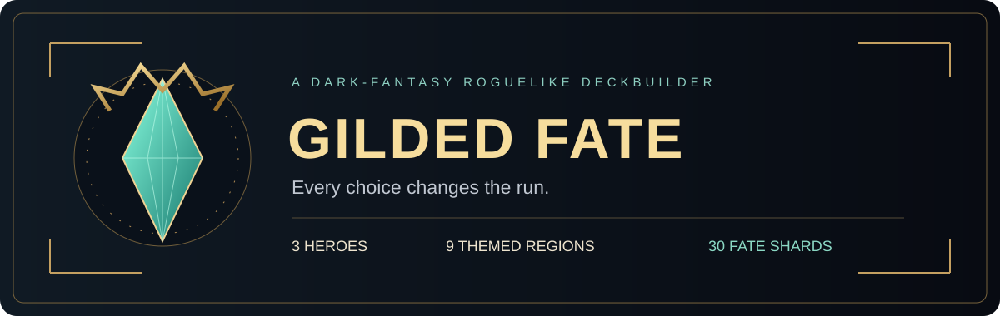
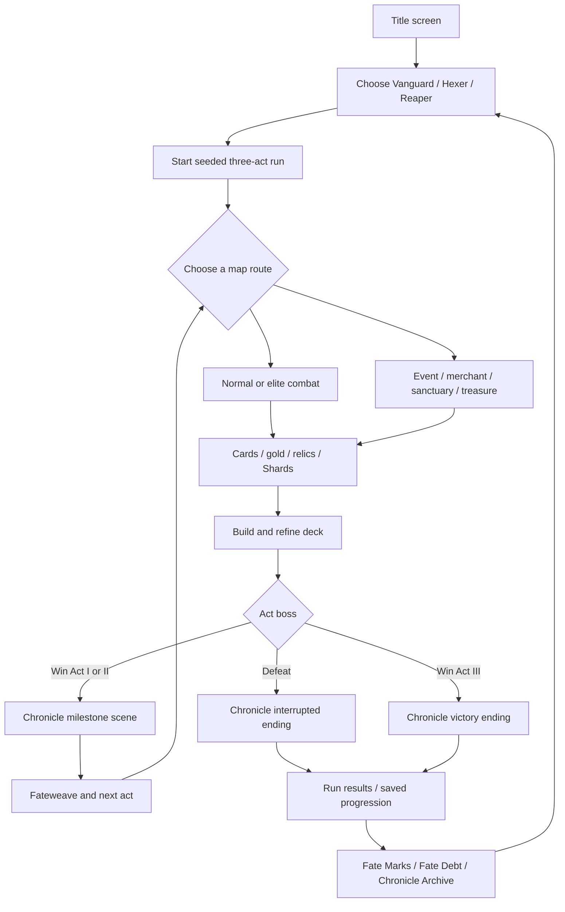
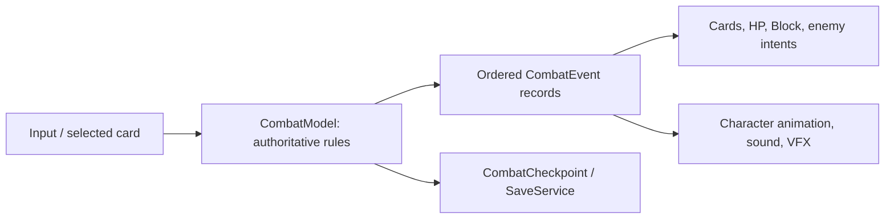
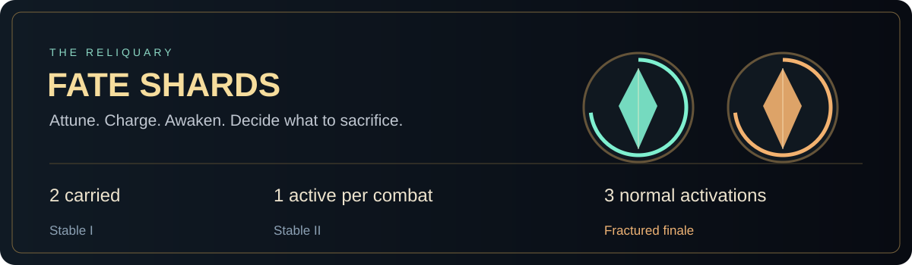
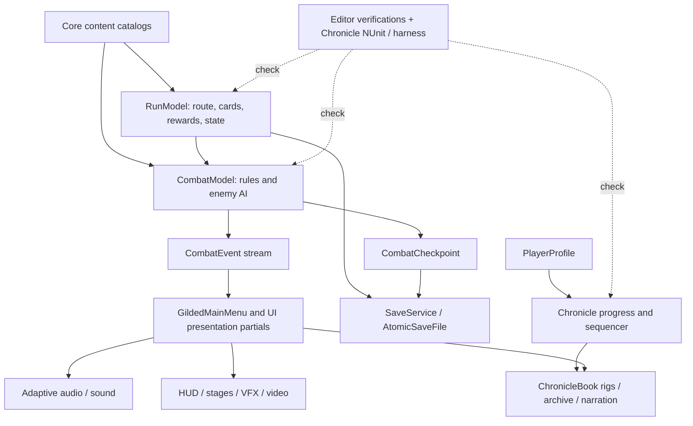

# Gilded Fate

<p align="center">
  
</p>

<p align="center">
  
</p>

<p align="center"><strong>Every card is a promise. Every relic remembers. Every path has a price.</strong></p>

<p align="center">
  
  
  
  
  
</p>

> **Repository:** [`riverhine1-max/gilded-fate`](https://github.com/riverhine1-max/gilded-fate)  
> **Project type:** Unity 6 game, C#, Universal Render Pipeline (URP), Unity UI, custom deterministic combat simulation, authored content catalogs, and Git LFS media.  
> **Documentation snapshot:** October 13, 2026. This document explains the repository as inspected on that date. **Source code and newer tests win over descriptions here.**

**Gilded Fate** is a single-player, dark-fantasy roguelike deckbuilder inspired by the strategic depth of games such as *Slay the Spire*, while built around its own heroes, mechanics, progression, art, and evolving narrative. Choose one of three playable heroes, climb through a branching three-act run, read enemy intentions, and assemble powerful interactions among cards, relics, Bindings, Fateweaves, and chargeable Fate Shards.

Its other defining feature is **The Chronicle of Broken Fate**: a physical, animated journal which remembers what the player has discovered and gradually revises the game's supposedly settled history. Story scenes occur automatically at run milestones. Higher difficulty victories add new recollections to the same book.

**For Codex / coding agents:** read [AGENTS.md](AGENTS.md) before changing code. It contains specific development boundaries, tests, preservation requirements, and the correct source-of-truth order. A task-specific request and the actual checked-out source must be inspected before any implementation.

## Contents

1. [The game in one minute](#the-game-in-one-minute)
2. [Design pillars](#design-pillars)
3. [Player loop](#player-loop)
4. [Playable heroes](#playable-heroes)
5. [Combat model and vocabulary](#combat-model-and-vocabulary)
6. [Acts, environments, and enemies](#acts-environments-and-enemies)
7. [Cards, relics, Bindings, and Fateweaves](#cards-relics-bindings-and-fateweaves)
8. [Fate Shards](#fate-shards)
9. [The Chronicle of Broken Fate](#the-chronicle-of-broken-fate)
10. [Meta-progression and settings](#meta-progression-and-settings)
11. [Art, audio, interface, and accessibility](#art-audio-interface-and-accessibility)
12. [Technical architecture and code map](#technical-architecture-and-code-map)
13. [Set up, play, and build](#set-up-play-and-build)
14. [Verification and Codex workflow](#verification-and-codex-workflow)
15. [Known gaps and status](#known-gaps-and-status)
16. [Documentation and licensing](#documentation-and-licensing)

## The game in one minute

| Question | Answer |
|---|---|
| What does the player do? | Choose a hero, navigate a seeded map, fight turn-based battles, collect rewards, improve a deck, defeat bosses, and uncover the world through repeated runs. |
| What makes combat interesting? | Visible enemy intents, exact resource sequencing, class-specific engines, permanent modifications to *individual card copies*, relic combinations, and charged Fate Shards. |
| How long is a run? | A branching **three-act** run. Exact duration depends on map, decisions, and player speed. |
| Which characters are playable? | **Vanguard**, **Hexer**, and **Reaper**. A future character should not be assumed to exist in the live roster. |
| What is the progression? | Fate Marks and unlock tiers, achievements, per-hero **Fate Debt I–X**, Daily Runs, records, and story discoveries. |
| Is there a story? | Yes. **The Chronicle** has the original nine chapters and 27 hero memories, shared red-ink corrections, a secret Chapter X, and **30 Fate Debt recollections** that deepen the existing stories. |
| Can it be played now? | The repository includes playable Unity scenes, a Windows playtest build workflow, and a WebGL deployment workflow; a successful *current* build must be checked in GitHub Actions rather than inferred from source alone. |
| Is the game finished? | No. This is an evolving project. Asset import, performance, animation quality, balance, and release-readiness require ongoing validation. |

## Design pillars

**1. Powerful builds through decisions, not free automatic wins.** It should be possible to build exciting engines that chain multiple cards, relics, and effects. A setup involving several deliberate pieces is desirable; accidental two-card infinite loops, unbounded replay recursion, and impossible-to-read interactions are not.

**2. Clear intent, fair consequences.** An enemy may be dangerous or deceptive in theme, but the rules it actually follows must be legible. Once a deterministic intent is shown, it cannot silently change. Where an intent visibly offers a random set of possibilities, the displayed set must be honest and complete.

**3. Each hero solves problems differently.** Vanguard protects and retaliates, Hexer constructs rituals, Reaper turns loss/exhaustion into resources. Generic cards from the **Wanderer** pool connect otherwise separate builds.

**4. Choices should outlive the moment.** Persistent card identities, upgrades, Bindings, relics, Shards, map decisions, and event consequences let the player recognize the results of a decision several fights later.

**5. Gameplay and presentation must agree.** Damage numbers, intent previews, tooltips, status icons, animations, and narration must describe the authoritative state, not invent a second version of events.

**6. The story must be discovered, not overwritten.** The Chronicle reveals more through play. New revelations should preserve exact original narration and corrections unless a separate, explicit writing change has been approved.

## Player loop



The simulation decides rewards and unlocks; cinematic playback should never be permitted to grant them a second time. Act I and Act II clear transitions resolve rewards before Chronicle playback and the next-act Fateweave. Final victory and defeat return to their normal results after the story presentation. Consult the current `GildedMainMenu` partials for exact transition ordering.

The run map uses a seeded branching structure with combats, elites, events, merchants, sanctuaries, treasure, and a boss. The run stores selected paths and authored node state so resuming a save must not silently reroll the world.

## Playable heroes

| Hero | Identity | Primary strategies | Starting deck (10 cards) | Starting HP |
|---|---|---|---|---:|
| **Vanguard** | Defensive warrior, pressure and counterattacks | Strength, Fortify, Block, Retaliate, Heavy hits, Revenge | 4 Strike, 4 Defend, 1 Battle Cry, 1 Stand Firm | 80 |
| **Hexer** | Ritual architect, setups and delayed payoff | Burn, Marked, Resonance, ordered Sigils, curse synergies | 4 Hex Strike, 4 Ward, 1 Invocation, 1 First Ritual | 68 |
| **Reaper** | Grave economy, sacrifice and recursion | Souls, Exhaust, generated/temporary cards, Marked, recovery, finishers | 4 Scythe Strike, 4 Death's Veil, 1 Soul Call, 1 Reaping Blow | 72 |

The exact **card IDs**, hero-specific starting relics, and current numeric balances are defined in [`RunModel.NewRun`](Assets/Scripts/Map/RunModel.cs); do not derive implementations from display names in this table. The active hero enumeration and data definitions are in the core code. Starting decks use individual persistent card instances, not a bag of anonymous identifiers.

### Vanguard

The Vanguard rewards protecting yourself *with a purpose*. Fortify and Strength contribute to attacks and defense; Block and Retaliate can turn enemy aggression into pressure. Heavy cards encourage planning Energy and cost changes rather than simply playing the highest-damage action available.

### Hexer

The Hexer uses **three ordered Sigil slots**: Ember, Hex, and Echo. Ember applies Burn, Hex applies Marked, and Echo prepares a finite repeat of a subsequent card. Sigil activations generate Resonance unless a card changes that rule. Position and activation order matter.

### Reaper

The Reaper uses **Souls**, Exhaust, generated cards, and graveyard-like recovery. Exhaust is not necessarily a loss: the class has ways to benefit when cards leave the ordinary draw/discard cycle. Any recursion must remain bounded and follow the engine's replay safeguards.

## Combat model and vocabulary

Combat is **turn-based and intent-driven**. The player draws cards, spends Energy on Attacks/Skills/Powers, resolves deterministic effects and triggered relics, then ends the turn to let enemies execute their shown plans. Deck reshuffling, draw/discard/exhaust zones, target selection, buffs, debuffs, and victory rewards are handled by the simulation.



| Term | Meaning in the game |
|---|---|
| **Energy** | Turn resource that pays for cards and certain actions. |
| **Block** | Reduces incoming damage before HP is affected. |
| **Strength** | Modifies appropriate Attack damage. |
| **Fortify** | Defensive resource used by Vanguard effects and Block interactions. |
| **Retaliate** | Defensive counterattack/response; only triggers when an enemy hit actually consumes Block under the current rules. |
| **Burn** | Stackable delayed damage, sometimes triggered early or amplified. |
| **Marked** | Enemy setup state consumed or exploited by other effects. |
| **Resonance** | Hexer resource produced and used by ritual chains. |
| **Sigils** | Three ordered slots with Ember, Hex, or Echo behavior. |
| **Souls** | Reaper-specific generated/consumed resource. |
| **Weak** | Reduces qualifying Attack output. |
| **Vulnerable** | Increases qualifying incoming Attack damage. |
| **Exhaust** | Removes the card from the normal combat deck cycle. |
| **Ethereal** | Disappears if left unplayed when the turn ends. |
| **Fate Debt** | The game's per-hero escalating challenge levels, not a combat debuff. |

**Calculation contracts are important.** See [`Assets/GILDED_FATE_GAMEPLAY_RULES.md`](Assets/GILDED_FATE_GAMEPLAY_RULES.md): attack damage is calculated per hit; base/permanent modifiers, flat additions, percent modifiers, penalties, Strength, Weak, Vulnerable, enemy protections, Block and HP damage have a documented order. Raw damage from Burn/Retaliate and similar sources is not treated as a standard Attack. Block gains have their own ordering, and triggers read the final gained amount. **Do not create a parallel damage or Block calculation path.**

Repeats produced by Echo, Golden Echo, Fateful, and similar effects must **not** recursively spawn their own repeats. Check current source and verification tests before changing trigger ordering.

### Enemy intents and multi-enemy encounters

The more recent themed combat code supports groups, owners, minions, support enemies, summons, and multi-phase bosses. Each active enemy has its own plan and state; summons and deaths can alter legal actions. Visual forecasts must continue to match the action that actually resolves. Summons follow ownership rules, and support-only formations may be resolved without requiring damage to harmless support units.

**Documentation age warning:** older gameplay-rule notes describe a one-enemy prototype and some early theme documents mention six possible enemies, while later Act III and neutral-content documents specify a four-enemy limit. **Inspect the current combat and encounter implementation for the actual active cap**, and update any affected tests/docs together. Do not hardcode an older document's limit without checking the model.

## Acts, environments, and enemies

The game has **three acts**, and the project now contains **nine authored non-Vault themes** with corresponding combat logic, enemies, elites, bosses, encounter formations, art paths, and presentation hooks. Legacy Vault definitions also remain in the code, including for save compatibility. Theme selection and eligible rosters are data-driven; it is not correct to describe the live repo as having only the original 17 enemies.

| Act | Authored themed region | Theme identity | Main docs / code |
|---|---|---|---|
| **I** | **The Gilded Ruins** | Seized Gold, formations, economic risk and protection | [`GildedRuins.md`](Docs/GildedRuins.md) / `GildedRuinsContent.cs` / `RuinsCombat.cs` |
| **I** | **Ashen Wilds** | Owners, summoned minions, hunger, shifting natural states | [`AshenWilds.md`](Docs/AshenWilds.md) / `AshenWildsContent.cs` / `WildCombat.cs` |
| **I** | **The Drowned Quarter** | Submersion, anchors, Pressure, disappearing Strings | [`DrownedQuarter.md`](Docs/DrownedQuarter.md) / `DrownedQuarterContent.cs` / `DrownedCombat.cs` |
| **II** | **The Crimson Foundry** | Heat, overload, Load, Armor, mechanical phases | [`CrimsonFoundry.md`](Docs/CrimsonFoundry.md) / `CrimsonFoundryContent.cs` / `FoundryCombat.cs` |
| **II** | **Hollowwood** | Growth, seeds, woodland life cycles and transformations | [`Hollowwood.md`](Docs/Hollowwood.md) / `HollowwoodContent.cs` / `HollowwoodCombat.cs` |
| **II** | **Shattered Observatory** | Forecasting, future intents, Energy memory and prediction | [`ShatteredObservatory.md`](Docs/ShatteredObservatory.md) / `ShatteredObservatoryContent.cs` / `ObservatoryCombat.cs` |
| **III** | **Black Cathedral** | Judgment based on the previous player turn | [`BlackCathedral.md`](Docs/BlackCathedral.md) / `BlackCathedralContent.cs` / `CathedralCombat.cs` |
| **III** | **Fractured Realm** | Echoes, fractures, repeats, false futures and mirrored actions | [`FracturedRealm.md`](Docs/FracturedRealm.md) / `FracturedRealmContent.cs` / `FractureCombat.cs` |
| **III** | **Gilded Throne** | Royal orders, guards, reserves, stances and countdowns | [`GildedThrone.md`](Docs/GildedThrone.md) / `GildedThroneContent.cs` / `ThroneCombat.cs` |

The **original Vault** roster remains separately registered. Act II and Act III theme documentation also includes the Vault as a possible route; verify the effective routing in `ActThemes`, `ThemeRosters`, `WorldContent`, and `RunModel` before changing selection. Act I's new themes replaced the old default route for new themed runs, but old saves are supported.

**Act-specific neutrals:** Twelve shared enemy definitions appear in appropriate themes of one act, with art variants matching the environment. There are normal and elite neutrals, neutral-only formations, and mixed groups. See [`Docs/NeutralEnemies.md`](Docs/NeutralEnemies.md) and `Assets/Scripts/Core/NeutralContent.cs` plus `Assets/Scripts/Combat/NeutralCombat.cs`.

Some recognizable theme bosses include **The Last Procession**, **Cinder Alpha**, **The Drowned Magistrate**, **The Iron Saint**, **The Heartroot**, **The Astral Curator**, **The Final Bishop**, **The Unmade**, and **The Sovereign**. Bosses commonly have phase-dependent art and explicit HP thresholds, rather than a generic scaling attack. Each region's dedicated document lists the complete roster, exact move values, formations, special statuses, VFX hooks, and encounter rules. Those files are the correct source for enemy-specific work; do not copy approximate stats from this README.

**Combat readability contract:** state pills and intent icons must distinguish Heat, Pressure, Growth, Judgment, Echo, ownership, Summon, Command, and other mechanics at a glance. Player/enemy equivalents should reuse shared icon definitions where appropriate. Intent previews must update when legal, visible changes affect a plan, not conceal a reroll.

## Cards, relics, Bindings, and Fateweaves

### Card content

A card has a stable **catalog ID**, class/origin (including neutral **Wanderer**), rarity, type, cost, effect data, readable description, and normally an upgraded form. The game contains hundreds of authored card definitions across playable classes, neutral cards, generated cards, statuses, and curses. Content has expanded since the older README's 250+ count, so use the catalogs for an authoritative count.

Each owned `RunCard` also has a **persistent instance ID** with fields for upgrading, special modification, permanent damage/Block bonuses, cost behavior, and Perfected growth. Two copies of the same catalog card can have different permanent properties. Preserve instance IDs across duplication, saves, and combat initialization.

**Authoritative source:** `Assets/Scripts/Core/GameContent.cs` and its expansion catalogs; `Assets/Scripts/Cards/CardData.cs`; `Assets/Scripts/Map/RunModel.cs` for persistent ownership; `Assets/Scripts/Combat/CombatModel.cs` and related partials for execution. `CardArchive.cs` handles collection-facing information.

### Relics

Relics are persistent passive rules which can change starting conditions, Energy, draw, triggers, damage, defense, rewards, and character engines. The rarity progression includes **Common**, **Uncommon**, **Rare**, **Boss**, and a special pool. Some rare and boss relics intentionally have constraints or trade-offs. Do not assume every relic is a flat numerical stat boost. Catalogs live in `GameContent.cs`, `MajorRelics.cs`, and the appropriate combat/run expansion modules.

### Bindings: one persistent change to a specific card

The live `WorldContent.Bindings` catalog includes **11 named Bindings** across the acts:

| Act availability | Examples / mechanics |
|---|---|
| I | **Serrated**, **Reinforced**, **Weighted**, **Quickened**: extra per-hit damage, Block, Heavy strength, or first-draw cost relief. |
| II | **Lingering**, **Gilded**, **Focused**, **Chained**: delayed returns, Block on first play, extra buff/debuff stacks, or sequencing rewards. |
| III | **Recurring**, **Fateful**, **Perfected**: first-Exhaust recursion, bounded every-third-play repeats, or increased upgraded base numbers. |

Eligibility depends on card properties and act. A card's special modification field does not accept a second Binding in the normal flow. Code and tests decide stacking and eligibility; do not treat Binding and Fateweave per-card effects as freely stackable.

### Fateweaves: act-boundary choices

Each act has **six authored Fateweave options** with different power levels. Act I options include Wanderer cards, cross-class cards, relics, removal at HP cost, and burdened rewards. Act II shifts toward permanent card enhancements and stronger trades. Act III includes Perfected upgrades, first-play echoes, expensive-card cost manipulation, and high-rarity trades.

The player sees a limited offered subset and **selects one**. The run also tracks the **cut/unselected strand** mechanic for Gold after the chosen boon resolves. Exact selection logic, costs, eligible targets and the placement of the final act's fate seal are in `RunModel` and `WorldContent`; do not move them based on descriptive text alone.

### Events, rewards, and merchants

Events are authored, conditional choices rather than generic random stat boxes. They may alter Gold, HP/max HP, cards, relics, Bindings, Shards, map visibility, future events, temporary status effects, or trigger a fight. The run remembers seen events, flags, follow-up scenes, banked event rewards, and deferred effects. Avoid rerolling a remembered event branch on load.

Important files: `EventContent.cs`, `EventStories.cs`, `EventFlavor.cs`, `EventSystem.cs`, `RunRewards.cs`, `RunMerchant.cs`, `RunModel.cs`.

## Fate Shards

<p align="center"></p>

**Fate Shards replace ordinary disposable potions with combat-long, limited-lifespan powers.** There are **30 authored Shard definitions**, each with a **Stable** and **Fractured** effect.

| Rule | Current design / implementation |
|---|---|
| Inventory | Two persistent Shard sockets; acquiring a new one can require replacement. |
| Preparation | Attune one Shard, or **Hold** two, before combat. |
| Charging | Playing a natural card fills a charge meter; archetype-matching plays add more. |
| Standard target | **9 charge** when a specialized matching archetype applies. |
| Other archetypes | **7 charge** if there is no special matching rule. |
| Hold target | **12 charge** to keep both eligible. |
| Per-fight use | At most **one Shard activation per combat**. |
| Lifespan | First two activations are Stable, third is Fractured; the Shard is consumed afterward. |
| Early Shatter | With the meter filled, use the Fractured power immediately and sacrifice remaining uses. |
| Save behavior | Attunement, charge, counters, and Shard states must survive combat checkpoints. |

A Shard's active power lasts for the rest of that combat. Automatic copies/replays of a card should not duplicate **natural card-play charge**. The `RunModel` stores Shard ownership and remaining uses; combat modules decide charge, activation, and individual power effects.

**Full guide and catalog:** [`FATESHARD_OVERHAUL_README.md`](FATESHARD_OVERHAUL_README.md). **Key source:** `CombatShardCharge.cs`, `CombatShards.cs`, `Assets/Scripts/Combat/CombatShardCharge.cs`, `Assets/Scripts/Combat/CombatShards.cs`, `Assets/Scripts/Map/RunModel.cs`. The **files under `Assets/` are live Unity files**; same-named root copies and patches must not be mistaken for the runtime source.

## The Chronicle of Broken Fate

The Chronicle is a second progression system that carries the world narrative through runs. It is *not* a separate game, a replacement combat system, or a sequence of ordinary text popups: it is a journal with real page turns, handwritten revelations, illustrations, two narratorial voices, corrections, and persistent reading state.

### Original story

- **Nine chapters**, each contributing one memory for **Vanguard, Hexer, and Reaper**: **27 base memories**, identified as `MEM_01` to `MEM_27`.
- **Ten shared corrections**, `CORR_01` to `CORR_10`, that preserve the original line, cross it out in red, and write the replacement underneath when discovered.
- A secret **Chapter X** with its own scene and revelations. The Archive prevents locked information from spoiling the mystery.
- Deterministic milestone unlocks, narrative facts, discovery order, a persistent Archive, replays, and configurable writing/opening options.

**Important change:** older `Docs/CHRONICLE_ARCHITECTURE.md` describes the *original* Chapter X prerequisite. With the newer Ascension integration, **Chapter X unlocks only when all three heroes complete their ten-recollection True Histories**, not merely by watching the original 27 memories. The authoritative rules are in `ChronicleAscensionProgress.cs` and its tests.

### Automatic story playback

- **After Act I and Act II boss clears:** normal act rewards resolve, then earned memories play on the book before the next act's Fateweave. The relevant act-boundary memory can play again even if it was already watched.
- **After a final victory:** newly earned memories play, followed by the shared run-ending book scene and any eligible new Fate Debt recollection, before the results screen. Playback code controls the exact queue.
- **After a defeat:** earned memories and an interrupted ending play before the ordinary defeat results.
- **The recurring interruption:** a conclusion is written as *The End* without being voiced, then struck out in red; the deeper Being rejects the ending. Defeat responses can vary. This scene is **presentation only** and cannot grant unrelated story facts, Chapter X completion, or a hero memory by itself.
- **Skipping:** resolves the final writing/correction state and safely continues progression. Pause/gameplay input guards must prevent double rewards or stuck transitions.

### The Ten Recollections: Fate Debt I through X

This expansion is present in the current repository, not merely a proposal:

| Property | Implementation |
|---|---|
| Total recollections | **30**, ten per hero; IDs `ASC_VAN_01`–`10`, `ASC_HEX_01`–`10`, `ASC_REA_01`–`10` |
| Unlock | Win the **exact next Fate Debt level** for that hero, one revelation per eligible real victory. Normal victories, defeats, repeated levels, skipped levels, sandbox runs, and replays do not advance it. |
| Major corrections | **4 per hero**, at levels **I, IV, VII, X**: 12 new `ASC_CORR_*` corrections that **do not overwrite** the 10 original corrections. |
| Smaller recollections | **6 per hero**, between major corrections, using silent handwriting or narration as authored. |
| Final recollection | Fate Debt X completes that hero's personal **True History**. All three are needed to unlock Chapter X under the updated progression. |
| Story safety | If the original base memory has not been watched, an earned recollection waits until its required discovery gate is met; it is not lost. |
| Presentation | Recollections become a permanent part of their existing memory pages, with Archive reading/replay and chapter markers. |
| Page movement | The journal travels physically to the relevant chapter; distant travel accelerates in the middle, slows to the destination, and respects Reduce Motion. |
| Associated assets | Six additional marginal studies and **45 new narrated recordings** indexed by exact text and measured timings. |

The original 27 memories, original ten corrections, and existing wording must remain intact. New scripts under `SourceAssets/ChronicleAscension/Scenes/` are the source package for the generated `ChronicleScripts.Ascension.cs`; modify story text only with explicit editorial approval and a matching audio/timing change.

### Physical book, ink, art, and narration

The repository includes the **finished Chronicle Blender source**, exported FBX and animations, Unity materials/textures, prefab and rig config, plus a procedural fallback book. See:

- [`SourceAssets/Chronicle/Gilded_Fate_Chronicle.blend`](SourceAssets/Chronicle/Gilded_Fate_Chronicle.blend) and `SourceAssets/Chronicle/AnimationExports/` for editable and exported model/animation assets.
- `Assets/Resources/Chronicle/BookModel/Chronicle.fbx`, `ChronicleBook.prefab`, `ChronicleBook.controller`, `ChronicleBookRigConfig.asset` for Unity runtime integration.
- `Assets/Scripts/ChronicleBook/` for book rig interfaces, tempo, page handling, renderer and audio hook.
- `Assets/Resources/Chronicle/Audio/DialogueIndex.json` and `Assets/Resources/Chronicle/Audio/Dialogue/` for indexed voice playback.
- `Assets/Resources/Chronicle/Illustrations/` for paintings and marginal studies.

**Voice synchronization contract:** the exact authored string, scene ID, command ID, speaker, clip and measured word intervals must agree. Handwriting is driven by the recorded clip's sample clock for voiced lines; do not approximate timing with an unrelated typing-speed timer. Muted narration still preserves readable text, and skipping cannot start leftover clips. The canonical `The End` event is not spoken. Music may duck under dialogue; voice volume is independently adjustable.

### Important Chronicle source files

| Responsibility | Paths |
|---|---|
| Story IDs, facts, chapters, base unlock rules | `Assets/Scripts/Chronicle/ChronicleCatalog.cs` |
| Canonical base scenes and added recollections | `Assets/Scripts/Chronicle/Scripts/ChronicleScripts.*.cs` |
| Content assembly and sequencing | `ChronicleScripts.cs`, `ChronicleScene.cs`, `ChronicleSequencer.cs`, `ChronicleState.cs` |
| Original progression, saved state | `ChronicleProgress.cs`, `ChronicleJournal.cs`, `ChronicleArchive.cs` |
| Ascension catalog, gating, data | `ChronicleAscensionCatalog.cs`, `ChronicleAscensionContent.cs`, `ChronicleAscensionProgress.cs` |
| Act and ending story selection | `ChronicleMilestoneScenes.cs`, `Assets/Scripts/UI/GildedChronicleMilestones.cs` |
| Book and on-screen presentation | `Assets/Scripts/ChronicleBook/`, `Assets/Scripts/UI/GildedChroniclePresentation.cs` |
| Archive UI and reading | `Assets/Scripts/UI/GildedChronicleArchive.cs` |
| Voice and handwriting | `ChronicleDialogueAudio.cs`, `ChronicleDialogueTiming.cs`, `ChronicleWriter.cs` |
| Save integration | `Assets/Scripts/Saving/ChronicleProfileBridge.cs`, `PlayerProfile.cs` |
| Dedicated tests | `Assets/Tests/EditMode/Chronicle*Tests.cs`, `Tools/ChronicleHarness/` |

The story engine assembly is designed to be independent of Unity rendering; the UI and book rig use explicit interfaces. Preserve this separation.

## Meta-progression and settings

- **Fate Marks:** earned across runs, used for unlocking class and Wanderer cards in progressive tiers. The profile stores the results.
- **Fate Debt I–X:** per-hero escalating difficulty, unlocked sequentially by victories. Examples include tougher elites, reduced gold, boss health increases, curse penalties, and run starting restrictions. Its level also drives The Ten Recollections.
- **Daily Run:** a UTC-date-based seed, hero, modifiers, and scored first attempt; later attempts are practice.
- **Records:** achievements, run history, statistics and card unlock progress.
- **Achievements:** 30 authored IDs tracked locally, with optional Steam integration.
- **Player settings:** graphics, audio, game speed, controls, accessibility, Reduce Motion/flash effects, UI presentation; dedicated Chronicle options are present in the Archive.
- **Developer Playground:** enables customized combat setup and admin tools in supported development/editor contexts, without treating the sandbox as a legitimate story victory.

For exact Fate Mark awards, unlock tiers and each Fate Debt rule, use [`Docs/MetaProgression.md`](Docs/MetaProgression.md) and `Assets/Scripts/Core/MetaUnlocks.cs` / `RunMeta.cs` / `PlayerProfile.cs`.

## Art, audio, interface, and accessibility

The visual identity is **dark fantasy with worn antique gold, near-black interiors, readable class distinctions, restrained emerald supernatural accents, tactile cards and physical book materials**. Visual clarity matters more than making every effect share one identical silhouette. Read [`Assets/Art/StyleGuide/GILDED_FATE_STYLE_GUIDE.md`](Assets/Art/StyleGuide/GILDED_FATE_STYLE_GUIDE.md).

Implemented or represented in the project:

- Combat HUD with per-target intents, status/power icons, scaling counters, card tooltips and dynamically changing values.
- Cards, relic reveals, rewards, merchants, sanctuaries, map/route selection, accessibility settings and controller navigation.
- Combat events, hit timing, card travel, damage feedback, hero video animation surfaces and 3D stage composition.
- Character-specific animation/video catalogs with fallback visuals when video is unavailable or motion is reduced.
- Adaptive music, categorized sound effects, recorded Chronicle narration, and independent audio controls.
- Theme-specific enemies and variants, portraits, arena art, animations/VFX hooks, and many imported art assets.
- A Blender-created Chronicle with animations, page anchors, handwriting, corrections and living illustrations.

**Not all available media is guaranteed to be fully integrated or production-final.** Some PNGs and video files are Git LFS objects; some themed enemy hooks have placeholder motion profiles. An asset's presence does not prove its rendering or playback has been checked in a packaged build.

Controls include mouse/keyboard and Xbox-style controller navigation. `Reduce Motion`, fast-mode paths, clear tooltips and legible icon states must be tested when changing UI. The settings documentation states that **button remapping is not yet included**; do not claim it works without implementing and testing it.

## Technical architecture and code map



### Runtime source of truth

| Area | Inspect first |
|---|---|
| Hero IDs and gameplay catalogs | `Assets/Scripts/Core/GameContent.cs`, `WorldContent.cs`, relevant `*Cards.cs` and `*Content.cs` |
| Seeded run, rooms, deck instances, act transitions | `Assets/Scripts/Map/RunModel.cs` and `Assets/Scripts/Map/Run*.cs` |
| Combat math and event generation | `Assets/Scripts/Combat/CombatModel.cs` and all its partial modules |
| Enemy patterns and themed rules | `Assets/Scripts/Combat/*Combat.cs` plus matching `Assets/Scripts/Core/*Content.cs` |
| Intent and status layout | `Assets/Scripts/Combat/EnemyTurnPlan.cs`, `EnemyIconRules.cs`, `PowerIconCatalog.cs`, UI `GildedEnemy*.cs` |
| Game UI and transitions | `Assets/Scripts/UI/GildedMainMenu.cs` and `Gilded*.cs` partials |
| Audio | `Assets/Scripts/Audio/`, `Assets/Scripts/UI/GildedAudioPresentation.cs` |
| Saved runs / profile / recovery | `Assets/Scripts/Saving/SaveService.cs`, `AtomicSaveFile.cs`, `PlayerProfile.cs` |
| Chronicle | `Assets/Scripts/Chronicle/`, `Assets/Scripts/ChronicleBook/`, Chronicle UI partials |
| Editor tools and checks | `Assets/Editor/` and `Assets/Scripts/UI/*Verification.cs` |
| Pure Chronicle tests | `Assets/Tests/EditMode/` and `Tools/ChronicleHarness/` |
| Unity packages and player settings | `Packages/manifest.json`, `ProjectSettings/` |
| Automated build definitions | `.github/workflows/build-game.yml`, `deploy-webgl.yml`, `ci/` |

### Repository map

```text
gilded-fate/
├── README.md                         # Player-facing and architecture overview
├── AGENTS.md                         # Rules and workflow for Codex / coding agents
├── FATESHARD_OVERHAUL_README.md      # Detailed Shard reference
├── Assets/
│   ├── Art/StyleGuide/               # Project's visual design rules
│   ├── Editor/                        # Import, previews, verifications, build menu items
│   ├── Resources/                    # Runtime art, fonts, enemy variants, Chronicle, audio, shaders
│   ├── Scenes/SampleScene.unity       # Main Unity scene
│   ├── Scripts/
│   │   ├── Audio/                    # Adaptive music and SFX
│   │   ├── Cards/                    # Card data representation
│   │   ├── Chronicle/                # Engine-independent story data/progression/sequence
│   │   ├── ChronicleBook/            # Rig, page turning, narration and render integration
│   │   ├── Combat/                   # Authoritative simulation + themed enemy rules
│   │   ├── Core/                     # Card/relic/enemy/event/theme catalogs
│   │   ├── Map/                      # Run loop, routes, shop, rewards, events
│   │   ├── Saving/                   # Profile/run persistence and Steam bridge
│   │   └── UI/                       # Screens, animation, readouts, verification
│   ├── StreamingAssets/              # Video, attribution, third-party notices
│   └── Tests/EditMode/               # Chronicle NUnit suite
├── SourceAssets/
│   ├── Chronicle/                    # Blender source, exports, QA/review videos
│   ├── ChronicleAscension/           # Canonical recollection source, art, audio, manifests
│   └── ChronicleAudio/               # Dialogue alignment/generation documentation/scripts
├── Docs/                              # Regional rules, architecture, status, Steam, updates
├── Tools/ChronicleHarness/            # dotnet harness: runs Chronicle tests without Unity
├── Packages/                          # Locked Unity dependencies
├── ProjectSettings/                   # Unity project/editor settings
├── ci/                                # Build and trailer tools
├── .github/workflows/                 # Windows/WebGL/Linux trailer builds and Pages deploy
└── Archive/                            # Upload inventory and legacy/temporary material
```

**Important:** the repository also has **root-level `.cs` duplicates**, patch files, and `GildedFate_VFX_Polish/` upload artifacts. Treat these as possible transfer/staging artifacts until proven otherwise. **Live Unity source is under `Assets/`**, not identically named files at repository root. Never bulk-copy over `Assets/` without inspecting diffs and checking Unity `.meta` GUIDs.

### Persistence and reliability

`RunModel` stores an authoritative list of `RunCard` instances. Legacy `deck` and `upgradedCards` lists exist as a save-migration bridge, not as an independent source to edit. The save layer uses backups and atomic replacement; combat checkpoints capture enough state for consistent recovery. UI presentation may read state and events but must not silently mutate gameplay rules. Keep run IDs, character progress, last displayed/replayed Chronicle facts, seed/RNG decisions and checkpoint compatibility stable.

## Set up, play, and build

### Requirements

- **Unity Hub** and **Unity `6000.5.9f1`** (exact project version in `ProjectSettings/ProjectVersion.txt`).
- Git and **Git LFS** (many game assets are large/binary).
- Platform build modules as needed: Windows Build Support and WebGL Build Support.
- For the standalone Chronicle harness: a compatible **.NET SDK** (the documented integration ran on .NET 8).

```bash
git clone https://github.com/riverhine1-max/gilded-fate.git
cd gilded-fate
git lfs install
git lfs pull
```

Open the root folder in Unity Hub, import packages/assets, then open **`Assets/Scenes/SampleScene.unity`** and enter Play Mode.

> **Clone rather than downloading GitHub's source ZIP** if you need a complete Unity working copy. A small file beginning with `version https://git-lfs.github.com/spec/v1` is an LFS pointer, not the actual PNG, WAV, FBX, or video. Do not replace these pointers with fabricated assets.

### Local Windows build

Use **File → Build Profiles**, select Windows and include `Assets/Scenes/SampleScene.unity`. The editor also includes an automated development-build route via `GildedFate.Editor.GildedFateAutomatedBuild.BuildWindows` (see `Assets/Editor/`). `ci/GildedFateCiBuild.cs` supplies CI-specific build entry points.

### Automated GitHub builds

| Workflow | Purpose | Output |
|---|---|---|
| [`Build Gilded Fate`](.github/workflows/build-game.yml) | Unity CI for Windows, WebGL, optionally Linux trailer-player | Windows `playtest` prerelease archive; WebGL artifact; trailer branch when requested |
| [`Deploy Gilded Fate WebGL`](.github/workflows/deploy-webgl.yml) | Deploys successful Pages artifacts from build workflow | Browser playtest via GitHub Pages, when configured and deployment succeeds |

The primary build workflow generally triggers on changes under `Assets/`, `Packages/`, `ProjectSettings/`, `ci/`, or its workflow definition. **Changing only the README or AGENTS.md does not automatically rebuild the game.** Current workflow success/failure and artifacts must be checked on GitHub.

- [GitHub Actions](https://github.com/riverhine1-max/gilded-fate/actions)
- [Windows playtest release](https://github.com/riverhine1-max/gilded-fate/releases/tag/playtest)
- [Repository](https://github.com/riverhine1-max/gilded-fate)

### Steam

Steam integration is **optional/not fully configured merely by including the scripts**. The project can run without Steam. Use [`Docs/SteamSetup.md`](Docs/SteamSetup.md) to configure Steam Auto-Cloud, install Steamworks.NET, enable `GILDED_STEAM`, and create matching achievement IDs in Steamworks. Verify build, disclosures, rights and store configuration separately before a Steam release.

## Verification and Codex workflow

**Work in small, reviewable changes.** Before editing, Codex should inspect the requested gameplay path, read the matching region/feature documentation, locate verification coverage, and produce a short impact assessment. Never implement a mechanic solely from this summary if concrete source contradicts it.

### Recommended test order

1. **Diff inspection:** make sure changes are inside intended Unity paths, no binary corruption, `.meta` replacements, generated-file truncation, or unrelated mass formatting.
2. **Pure Chronicle tests:** `dotnet run --project Tools/ChronicleHarness` where a compatible SDK exists. Report actual result, not a presumed pass.
3. **Unity tests:** in the Editor, **Window → General → Test Runner → EditMode**. Run full tests when chronology, saving, loading, or key gameplay systems change.
4. **Targeted editor checks:** use the relevant `Assets/Editor/*Verification.cs` and `Assets/Scripts/UI/*Verification.cs` entry points, especially the quality gate and run-flow checks.
5. **Manual Play Mode smoke test:** start all three heroes, trigger each signature system, fight themed groups, visit events/merchant/sanctuary, save/reload mid-combat, clear a boss, replay Chronicle, test defeat and victory, and verify reduced motion and controller input.
6. **Packaged builds:** only describe Windows/WebGL as passing after a real build and hands-on smoke test. Track each CI run against its commit SHA.

**Published test evidence, not a fresh claim:** the October 13, 2026 Chronicle Ascension integration report documents **226/226 passing tests** in the standalone .NET harness and validation of 30 story scenes, 45 recordings and six art studies. **That report explicitly says Unity Editor compile/Play Mode and new narration playback had not yet been run for that integration.** See [`TEST_RESULTS.md`](SourceAssets/ChronicleAscension/Documentation/FinalIntegration/TEST_RESULTS.md) and [`REMAINING_ISSUES.md`](SourceAssets/ChronicleAscension/Documentation/FinalIntegration/REMAINING_ISSUES.md). Older module-specific results must not be presented as proof of current packaged-build health.

### Example task checklist for an agent

```text
Before:
- Read AGENTS.md, this README, and matching Docs/ feature documents.
- Confirm the current branch, intended task, and whether files changed since docs were written.
- Identify the model, UI, save, asset and test surfaces affected.

During:
- Make the smallest compatible changes.
- Keep deterministic combat, visible intents, and individual card identities consistent.
- Preserve canonical story IDs, original lines, recordings, Unity GUIDs and LFS assets.
- Do not create a duplicate engine or copy root staging files over Assets/.

After:
- Run available targeted tests and describe which could not run.
- Check the full diff and verify no unexpected asset movement.
- State precisely what changed, why, any remaining risks, and how to test in Unity.
```

## Known gaps and status

The presence of a system or asset is not evidence of finished quality. In particular:

- **Chronicle Ascension** has integrated content and standalone test coverage, but its final-integration report still requests **Unity verification, per-hero Fate Debt victory playtests, animation/page-flip review, and listening review of all 45 new recordings**.
- New audio index entries and voices must stay aligned; do not silently substitute guessed timings if audio is changed.
- Some specific Chronicle visual details are intentionally simpler than their concept goals: marginal studies are static in some views, silent passage pacing is not per-sentence, and long paragraphs may span pages.
- Dedicated new Chronicle ambience, Foley, and music themes were **not** added by the cited integration; original music and SFX are reused.
- Root-level duplicate code/upload artifacts must be reconciled manually, not assumed active.
- Full key/controller remapping was not implemented in the referenced settings documentation.
- Playtesting and balance remain essential for growing encounter rosters, multi-enemy AI, status readability, VFX performance and save migrations.
- Steamworks configuration, store readiness, current CI health and production rights/disclosures require separate checks.

These are **known verification or production needs**, not permission to delete systems or change their intended design. For new tasks, confirm whether they have already been fixed on a later commit.

## Documentation and licensing

### Read these before making feature changes

| Topic | Reference |
|---|---|
| Combat stacking rules | [`Assets/GILDED_FATE_GAMEPLAY_RULES.md`](Assets/GILDED_FATE_GAMEPLAY_RULES.md) |
| Shards (complete 30-item catalog) | [`FATESHARD_OVERHAUL_README.md`](FATESHARD_OVERHAUL_README.md) |
| Individual regions and exact enemy rosters | [`Docs/`](Docs) region files listed above |
| Cross-theme neutral enemies | [`Docs/NeutralEnemies.md`](Docs/NeutralEnemies.md) |
| Chronicle foundations | [`Docs/CHRONICLE_ARCHITECTURE.md`](Docs/CHRONICLE_ARCHITECTURE.md) |
| Chronicle finished book | [`Docs/CHRONICLE_BOOK_REPLACEMENT.md`](Docs/CHRONICLE_BOOK_REPLACEMENT.md) |
| Chronicle narration sync | [`Docs/CHRONICLE_VOICE_SYNC.md`](Docs/CHRONICLE_VOICE_SYNC.md) |
| Automatic run-end scenes | [`Docs/Updates/Chronicle_Milestone_Fix.md`](Docs/Updates/Chronicle_Milestone_Fix.md) |
| New Ascension integration and known issues | [`SourceAssets/ChronicleAscension/Documentation/FinalIntegration/`](SourceAssets/ChronicleAscension/Documentation/FinalIntegration) |
| Meta-progression and controls | [`Docs/MetaProgression.md`](Docs/MetaProgression.md) |
| Steam setup | [`Docs/SteamSetup.md`](Docs/SteamSetup.md) |
| Motion and presentation | [`Docs/CombatAnimationPlayback.md`](Docs/CombatAnimationPlayback.md) |
| Detailed audit | [`Docs/PolishAudit.md`](Docs/PolishAudit.md) |
| Audio/third-party credits | `Assets/StreamingAssets/AUDIO_CREDITS.txt` and `Assets/StreamingAssets/ThirdParty/` |

**Ownership and rights:** Original Gilded Fate code, writing, audio, and artwork are not automatically released as open-source merely because this repository is public. No general open-source license is granted in the inspected project README. Follow each third-party asset's individual license and attribution terms. Do not introduce third-party assets without checking rights and redistribution conditions.

---

<p align="center"><em>Choose a champion. Build an impossible deck. Descend into a Vault that remembers every bargain.</em></p>
